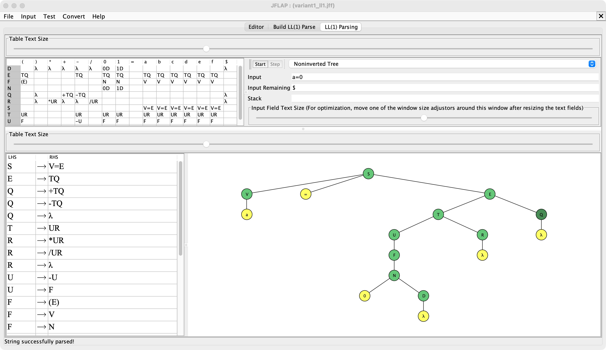
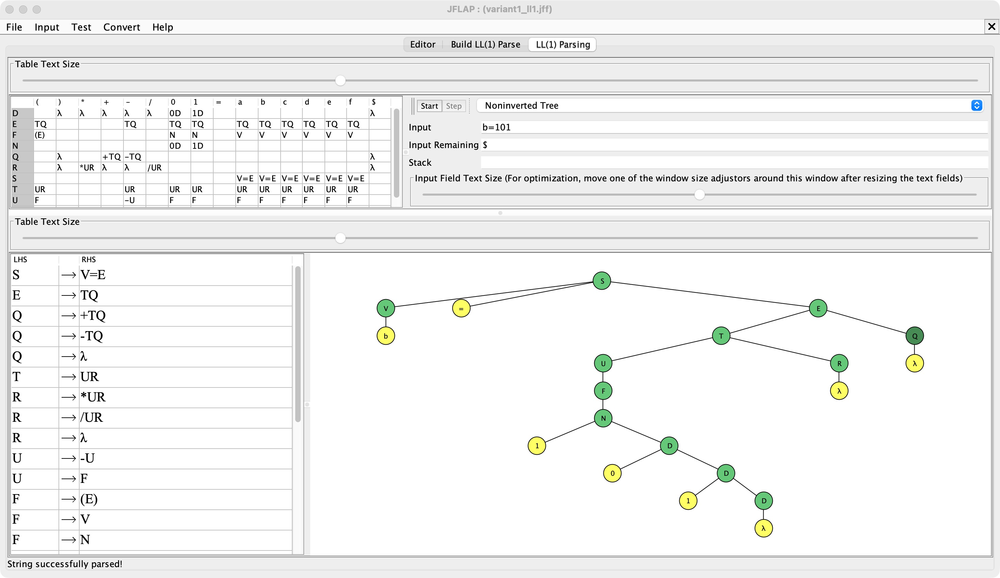
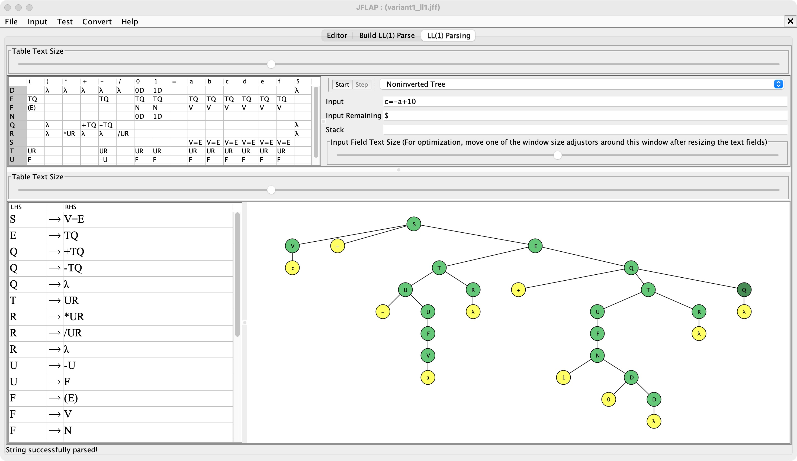
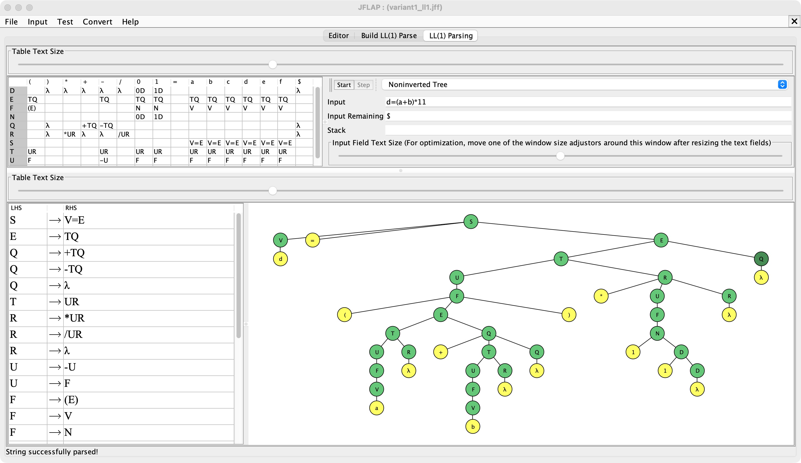
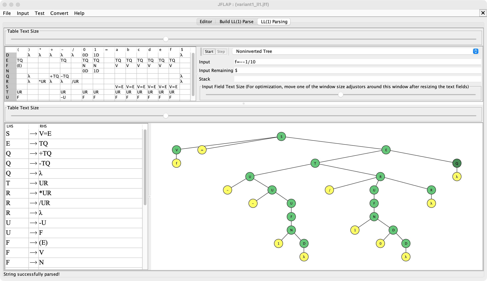
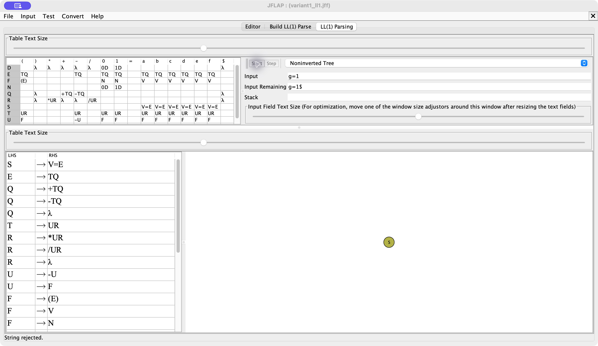
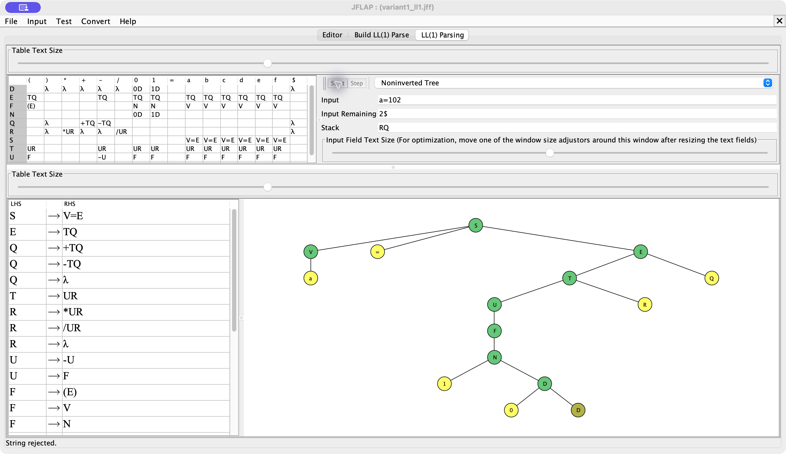
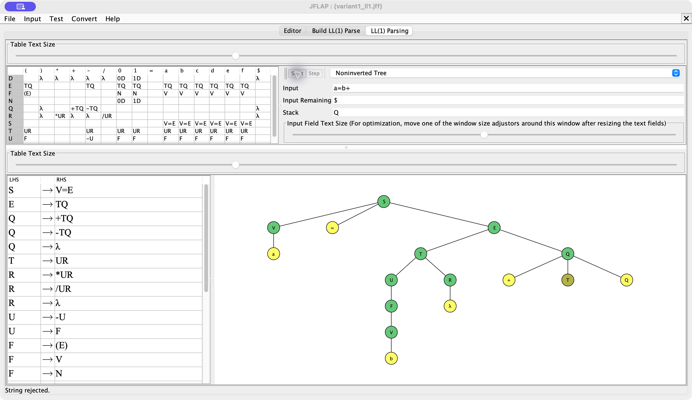

# 4. Распознавание тестовых цепочек LL(1)-автоматом

Проверка выполнена в штатном окне `LL Parse` системы JFLAP 7.1. На каждом реальном снимке видны таблица предсказывающего анализа, входная цепочка, дерево разбора и итоговое сообщение JFLAP. 

| № | Цепочка | Результат | Причина |
|---:|---|:---:|---|
| 1 | `a=0` | Accepted | корректная переменная и двоичная константа |
| 2 | `b=101` | Accepted | многоразрядная двоичная константа |
| 3 | `c=-a+10` | Accepted | унарный минус и сложение |
| 4 | `d=(a+b)*11` | Accepted | скобки и умножение |
| 5 | `f=--1/10` | Accepted | два унарных минуса и деление |
| 6 | `g=1` | Rejected | переменная `g` вне диапазона `a`–`f` |
| 7 | `a=102` | Rejected | цифра `2` не входит в двоичный алфавит |
| 8 | `a=b+` | Rejected | отсутствует правый операнд |

## Принятые цепочки

### 1. `a=0`

### 2. `b=101`

### 3. `c=-a+10`

### 4. `d=(a+b)*11`

### 5. `f=--1/10`

## Отклоняемые цепочки

### 6. `g=1`

### 7. `a=102`

### 8. `a=b+`

Сводный протокол сохранен в [test_results.txt](./test_results.txt).
