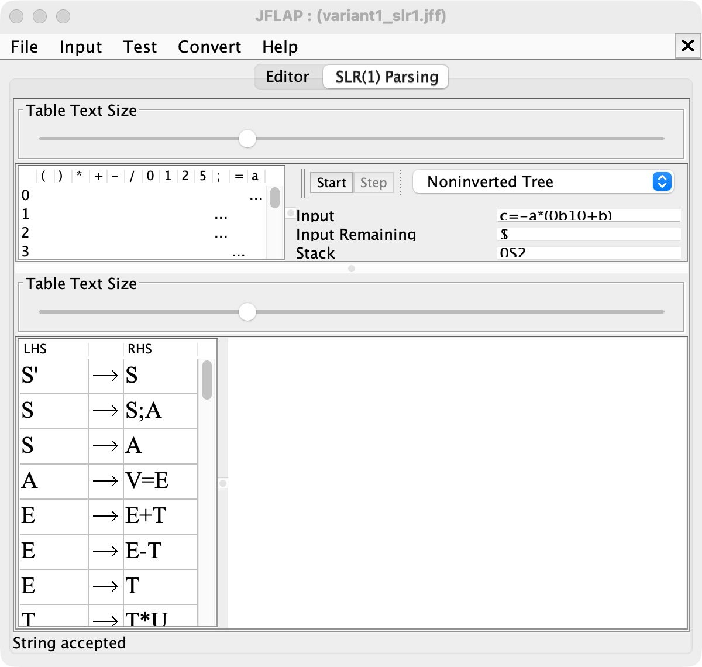
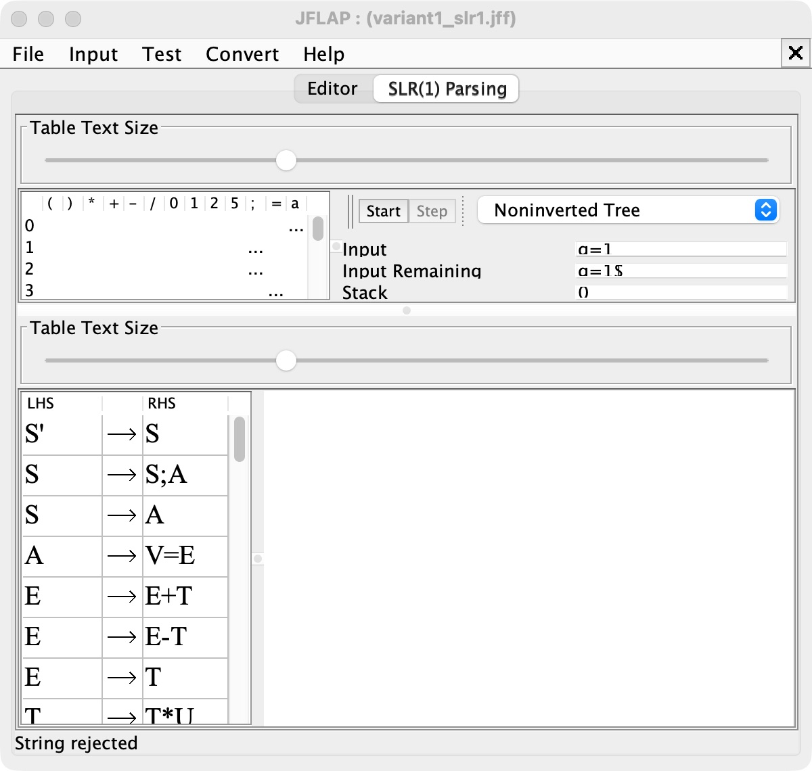
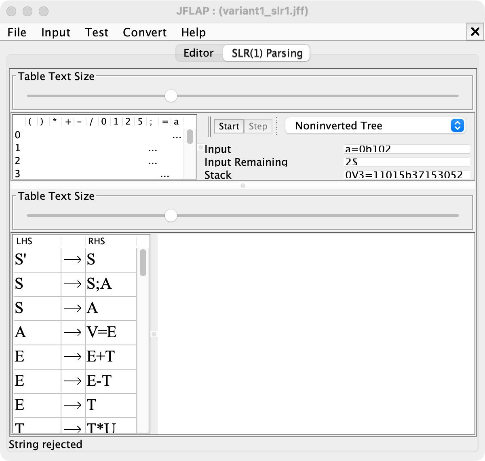
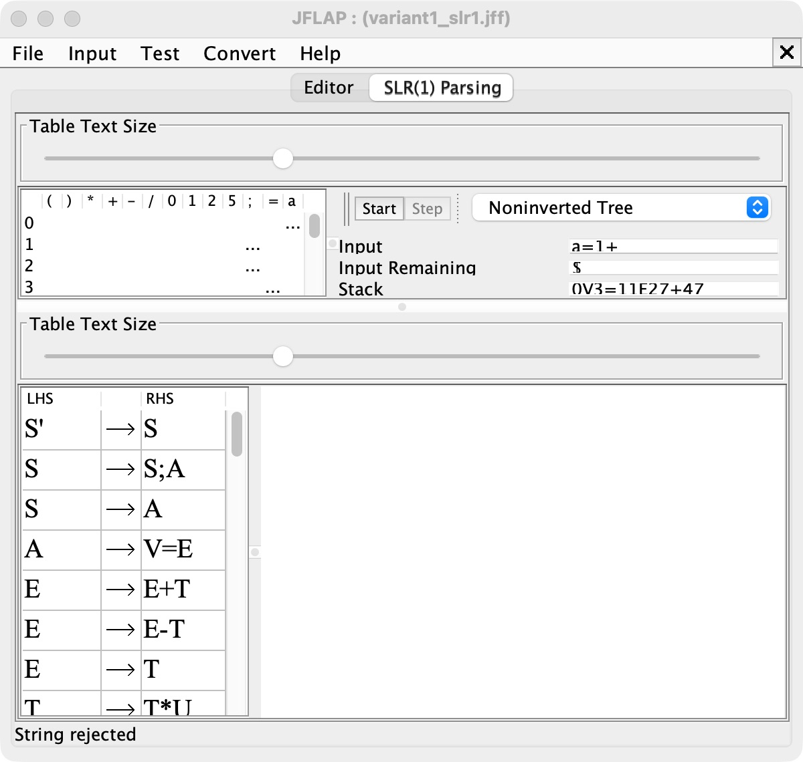

# 6. Распознавание тестовых цепочек SLR(1)-анализатором

Проверка выполнена таблично-управляемым алгоритмом в штатном окне `LR Parse` системы JFLAP 7.1. В JFLAP загружены полученная грамматика и вычисленная таблица ACTION/GOTO без конфликтов. На каждом реальном снимке видны таблица, вход, стек, дерево разбора и итоговый статус. 

| № | Цепочка | Результат | Причина |
|---:|---|:---:|---|
| 1 | `a=0b101` | Accepted | двоичная константа |
| 2 | `b=25+f` | Accepted | десятичная константа и переменная |
| 3 | `c=-a*(0b10+b)` | Accepted | унарный минус, двоичная константа и скобки |
| 4 | `a=1;b=a+10` | Accepted | последовательность двух операторов |
| 5 | `f=11/1-0` | Accepted | деление и вычитание |
| 6 | `g=1` | Rejected | переменная `g` вне диапазона `a`–`f` |
| 7 | `a=0b102` | Rejected | цифра `2` недопустима в двоичной константе |
| 8 | `a=1+` | Rejected | отсутствует правый операнд |

## Принятые цепочки

### 1. `a=0b101`

### 2. `b=25+f`

### 3. `c=-a*(0b10+b)`

### 4. `a=1;b=a+10`

### 5. `f=11/1-0`

## Отклоняемые цепочки

### 6. `g=1`

### 7. `a=0b102`

### 8. `a=1+`

Сводный протокол сохранен в [test_results.txt](./test_results.txt).
